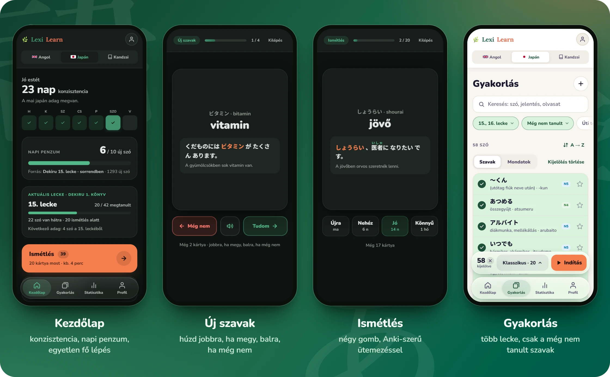
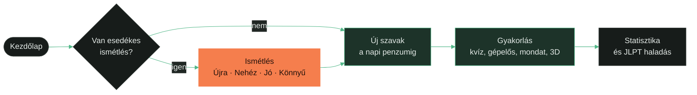
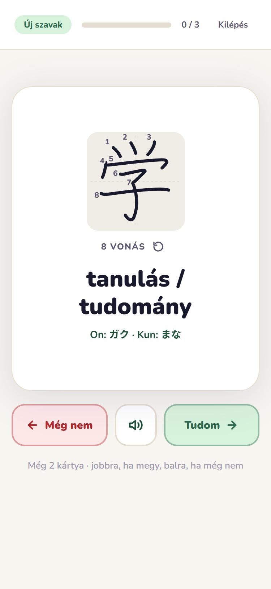
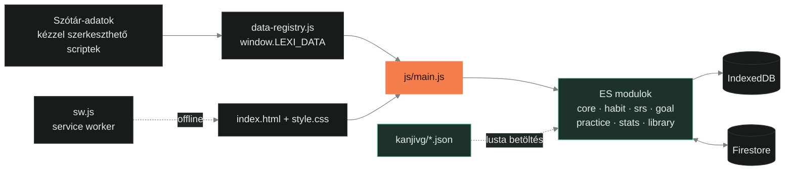

<p align="center">
  <a href="https://nokedli25ttv.github.io/LexiLearn/">
    
  </a>
</p>

<p align="center">
  <a href="https://nokedli25ttv.github.io/LexiLearn/"></a>
  
  
  
  <br>
  
  
  
  
</p>

<p align="center">
  <b>Szótanuló, ami a napi szokásra épít, nem a hajrára.</b><br>
  Japán a JLPT N3 felé (kana, szókincs, kandzsi vonássorrenddel), mellette angol.<br>
  Telefonra, egy kézre, offline is, több eszköz között szinkronban.
</p>

---

## Így néz ki

<p align="center">
  
</p>
<p align="center">
  
</p>

<p align="center"><sub>A képek az app <a href="https://nokedli25ttv.github.io/LexiLearn/tools/demo.html">demójából</a> készültek: generált tanulási előzménnyel indul, és semmit nem ment el.</sub></p>

> [!TIP]
> Telefonon nyisd meg az [élő verziót](https://nokedli25ttv.github.io/LexiLearn/), és a böngésző menüjéből add hozzá a kezdőképernyőhöz. Így teljes képernyős appként indul, és internet nélkül is működik.

## Egy nap a LexiLearnnel



A Kezdőlapon mindig egyetlen korall gomb mutatja a következő lépést: ha van esedékes ismétlés, az jön először, utána az új szavak. A napi limit szándékos: módonként 10 új szó (kandzsiból 5, a Profilban állítható), hogy a tudás rögzüljön, és ne legyen kiégés.

## Minden, ami benne van

### Napi szokás, nem hajrá

- **Konzisztencia:** hány egymást követő napon tanultál, alatta a hét napjai pöttysorban. A kihagyott nap nem büntetés, csak tény.
- **Napi penzum:** japán módban automatikusan a Dekiru 1. leckétől halad előre, leckénként; ha egy lecke végén kevesebb szó marad a napi célnál, a következő leckéből tölti fel az adagot. A Gyakorlás fül szűrői ezt nem módosítják.
- **Aktuális lecke:** a Kezdőlapon látszik a lecke haladása, a hátralévő és ismétlés alatt álló szavak száma, valamint a következő napi adag lecke szerinti összetétele.
- **A lecke nehéz szavai egy koppintással:** a leckekártya alatt, ha a leckében van zászlós, makacs vagy elrontott (még nem sorozatban menő) szó. A Gyakorlás fül beállításaival indul, a kijelölésedhez nem nyúl, és a végén a Kezdőlapra tér vissza.
- **Előrejelzés:** egy csendes sor arról, mennyi ismétlés jön holnap és a következő héten, hogy ne érjen meglepetés.
- **Napi feladatok:** naponta három, változó feladat, például egy hibátlan kör, tematikus nap, a nap szava, régen látott szavak vagy a legtöbbször elrontott szavak javítása.
- **Egyetlen ünneplés:** konfetti csak akkor, ha a napi cél teljesült, és akkor is naponta egyszer.

### Új szavak: húzható kártyák

- Jobbra húzva „Tudom”, balra „Még nem”; a pecsét a húzás mértékével jelenik meg, küszöb felett a kártya kirepül.
- Koppintásra megfordul: jelentés, kandzsi írásmód, romaji és egy példamondat furiganával, magyar fordítással.
- **Kandzsi ↔ szó:** a japán szó hátoldalán a benne lévő kandzsik a jelentésükkel (名 név · 前 előtt), a kandzsi hátoldalán legfeljebb három szó, amelyben szerepel (a már megtanultak elöl). Az írásmód a szó saját adatából vagy a saját példamondataiból jön, csak ha egyértelmű.
- A „Még nem” kártya a sor végére kerül, és addig visszajön, amíg egyszer nem megy.
- Kiejtés japánul, angolul és magyarul (iOS kezdőképernyős appban is, a némító kapcsoló mellett is szól, ha a Zene mellett ki van kapcsolva), billentyűzettel a nyilak és a Szóköz is működik.

### Ismétlés: Anki-szerű ütemezés (FSRS-5)

- Négy gomb: **Újra, Nehéz, Jó, Könnyű**, mindegyik alatt a következő ismétlésig hátralévő idő („ma”, „3 n”, „2 hó”).
- 90%-os célzott megtartás, napi felbontás; a „Rögzült” szó ismétlési köze legalább 21 nap.
- Egy alkalom alapból legfeljebb 20 kártya (a Profilban módonként 10, 20, 30 vagy 50); az „Újra” még aznap visszajön. Húzással (balra Újra, jobbra Jó) és az 1-4 billentyűkkel is értékelhetsz.
- A napi tanulás „Tudom” gombja csak elkezdi a szót (Tanulás alatt): kap ismétlőkártyát, de megtanult csak két egymás utáni sikeres ismétlés után lesz.
- A szabad gyakorlásban ötször egymás után helyesen megválaszolt szó (egy hiba újraindítja a számolást) megtanult, és ő is ismétlőkártyát kap. A kör végén Nehéz / Jó / Könnyű gombbal dönthetsz az első ismétlésről (1, 3 vagy 16 nap), különben 3 nap múlva jön. A korábban így megtanult szavak módonként napi legfeljebb 5-tel kerülnek be. Egy gyakorlási hiba a kártyát holnapra hozza.
- **Kezelhető ismétlési sor:** minden kártyán látszik a lecke, a bekerülés oka és az esedékesség; a kártya holnapra vagy egy héttel halasztható, szüneteltethető és később visszaállítható.

### Radikálok: a 214 Kangxi-radikál (a KanjiRadical projektből)

- Negyedik mód az Angol, Japán és Kandzsi mellett, saját napi penzummal (alapból 5), ismétléssel, statisztikával és haladással; a JLPT-sávba nem számít bele.
- Minden radikálnál a busu-név (pl. *hito*), a magyar jelentés, az on és kun olvasat és a JLPT-szint, ha önálló kandzsiként is az.
- **Radikál-útvonal:** 22 lecke, leckénként 10 radikál, olyan sorrendben, hogy minden új radikál a lehető legtöbb gyakori kandzsit tegye teljessé (日 木 月 人 大 一 口 土 寸 丨 az első lecke). A napi új radikálok ebben a sorrendben jönnek, a Gyakorlás fülön leckénként szűrhetők.
- **Cél és lefedettség:** a Haladás képernyőn választható cél (50%, 80%, 90% vagy mind a 214) és célidőpont (alapból fél év). Egy kandzsi akkor lefedett, ha minden radikálját tudod; a szöveg-lefedettség azt mutatja, hogy a japán Wikinews és Wikipédia kandzsi-előfordulásainak mekkora része ilyen. A 80%-hoz 11 lecke (110 radikál) kell; mellette a hátralévő radikálok, a szükséges heti tempó, az utóbbi 14 nap átlaga és a várható célba érés, mint a JLPT-haladásnál.
- Vonássorrend és **Írás** gyakorlat a csak elemként élő radikálokhoz is (a 辵, 靑, 戶 vonásai a mai 辶, 青, 戸 alakból).
- **Kandzsi ↔ radikál:** a kandzsi kártyáján a radikáljai (休 → 亻 人 · ember + 木 fa, a szótári radikál kiemelve, a már megtanultak pipával), a radikál kártyáján a kandzsik, amelyekben szerepel (a már megtanultak elöl). A felbontás a KanjiVG elemfájából készül (`tools/build-radicals.mjs`).
- **A Kandzsi mód a radikál-haladáshoz igazodik:** ha már tanulsz radikálokat, a napi új kandzsik közül szintenként előre jönnek azok, amelyeknek minden radikálját tudod (a többi utánuk, a szokásos sorrendben). A Kezdőlap sora mutatja, hány kandzsi kész, és mennyit nyit meg a következő radikál-lecke; a radikál tanulás végén egy sor jelzi az így megnyílt kandzsikat.

### Kandzsi: 1715 írásjegy, vonássorrenddel és írásgyakorlással

<table>
<tr>
<td width="50%" valign="top">

- N5-től N1-ig, magyar jelentéssel, on és kun olvasattal, romajival, témakörökkel.
- A kártya hátoldalán egy írásgyakorló négyzetben **a kandzsi vonásonként megrajzolódik**: az épp rajzolódó vonás zöld, a kész tintaszínű, a sorszám a vonás kezdetén jelenik meg.
- Alatta a vonások száma és egy újrajátszás gomb. Csökkentett mozgás beállítás mellett a kész, számozott ábra látszik.
- **Írásgyakorlás:** a jelentésből kell megrajzolni a kandzsit ujjal, vonásról vonásra. Minden vonást a szabályos alakhoz mér az app (kezdőpont, végpont, alak, irány, sorrend): a jó vonás a helyére ugrik, a hibás halványan eltűnik, két hiba után megmutatja, hogyan megy. Van Körvonal (átrajzoláshoz, pontozás nélkül), Segítség, Elölről és Nem tudom.
- Az adat a [KanjiVG](https://kanjivg.tagaini.net) projektből jön, szintenként töltődik le, és utána offline is megvan.
- A V13.9-es kiadás minden kandzsit átnézett: 337 javítás a jelentésekben, az olvasatokban és a romajiban.

</td>
<td width="50%" align="center">

<br><sub>világos témában, a kész ábrával</sub>
</td>
</tr>
</table>

### Gyakorlás: a teljes szótár kézben

- **Keresés** szóra, jelentésre és olvasatra; **lenyíló szűrőpillák:** Lecke (Dekiru), Állapot, Úti terv (nap), Témakör, Szint, Lista, Rendezés. Egyszerre **több lecke** is kijelölhető, az **Állapot** szűrővel pedig csak a még nem tanult (vagy csak a megtanult) szavak maradnak a listán. A témakörök darabszámai a többi aktív szűrő (például a kiválasztott lecke) találataiból számolódnak, a leckelistában pedig külön jelölés mutatja a Dekiru 2. könyv kezdetét a 25. leckénél.
- Szavak és Mondatok nézet, kijelölés, csillag (könyvjelző), saját listák. A kijelölt szavak a Lista menü aljáról **Anki-importfájlként** is letölthetők (japánnál elöl írásmód és kana, hátul jelentés és romaji, címkékkel).
- **Makacs szavak:** az app magától felismeri, ami többször is kifogott rajtad (az ismétlésben legalább 4 visszaesés, vagy a gyakorlásban legalább 4 hiba, legalább annyi, mint a helyes). A Kezdőlapon egy csendes sor jelzi, egy koppintással kijelölve a Gyakorlás fülre visz; ha a szó már megy, magától kikerül.
- **Leckék fókusz listái:** gyakorlás közben a kártya zászlójával egy nehéz szó a saját leckéjének fókusz listájába kerül (a csillagos Fókusz Listától külön). A Lista menüben leckénként külön szakaszban jelennek meg, így egy lecke nehéz szavai külön gyakorolhatók.
- **Lebegő dokk** a képernyő alján: a kijelöltek száma, a beállítások összefoglalója és a korall Indítás gomb.
- **Hét gyakorlástípus:**

| Típus | Mit csinálsz |
|---|---|
| Klasszikus | négy válaszból választasz; a zavaró válaszok hasonló szavakból jönnek |
| Gépelős | beírod a választ; japánnál kanával vagy romajival is jó, és a romaji élőben kanával is látszik |
| Mondat-kiegészítő | a szó a példamondatban hiányzik |
| 3D kártya | megfordítod, és elhúzod, ha tudtad |
| Hallás | japán és angol módban: csak hallod a szót, és a jelentését választod; az azonos hangzású szavak nem zavaró válaszok |
| Mondatépítő | japán és angol módban: a példamondat darabjait (furiganával) a magyar fordítás alapján sorba rakod; a szórendet gyakorolja, ezért a szó megtanulásába nem számít bele |
| Írás | kandzsi módban: megrajzolod a kandzsit vonásonként |

- Irány (kana → magyar vagy fordítva), kérdésszám (10, 20, 30, 50 vagy mind), sorrend (véletlen, betűrend, könnyebb vagy nehezebb elöl).
- Körökben halad: a hibás szavak a következő körbe kerülnek. A kör végén pontosság, helyes és hibás válaszok, idő, és a hibás szavak listája.
- **Úton a megtanuláshoz:** a Statisztikában a még nem megtanult szavak az 5 egymás utáni helyes felé csoportosítva (4/5, 3/5, 2/5, 1/5), pöttysorral és a szavakkal; egy sorra koppintva a teljes lista nyílik. A Szavak táblázat és a Gyakorlás fül szólistája is „3/5” formában mutatja az állást.
- **Megtanult szó visszajelzése:** amikor egy szó gyakorlás közben eléri az 5 egymás utáni helyes választ, a kártyán „Megtanult szó” jelvény bukkan fel; a kör végén külön lista mutatja, mely szavak kerültek a megtanultak közé ebben a gyakorlásban (itt választható ki az első ismétlésük), és az Előzményekben is látszanak.

### Statisztika és JLPT N3 haladás

- **KPI sáv:** Konzisztencia, Aktív napok (30), Rögzült szavak, Fókusz a héten.
- **Konzisztencia hőtérkép** GitHub-stílusú naptárban, **tudás-érettség** (Ismerkedés, Gyakorlás alatt, Rögzült), **pontosság** és **fókuszált idő** az elmúlt 14 napról. Minden ábrának van táblázatos nézete is.
- A tudás-érettség, a JLPT-haladás és a tanulási forrás számai megnyithatók: külön listázhatók a napi tanulásból, az 5× egymás után helyes gyakorlásból (dátummal, a legfrissebb elöl), az aktív ismétlésből és a rögzült állapotból származó szavak. A „Hogyan számoljuk?” nézet képlettel vezeti le a JLPT-összesítést.
- A Konzisztencia, Aktív napok és Fókusz KPI-k napi bontást nyitnak válaszszámmal, új szavakkal és aktív idővel.
- **Heti összefoglaló:** hetenként lapozható képernyő az aktív napokkal és négy számmal (megtanult szó, válasz és kártya, pontosság, fókuszált idő), mindegyik az előző héthez mérve. Alatta az N3 haladás heti változása, a héten elrontott és azóta nem javított szavak egy „Gyakorlás ezekkel” gombbal, és a módonkénti bontás. A lezárt hétről egy csendes sor szól a Kezdőlapon, amíg meg nem nézted.
- **JLPT haladás:** mérföldkő-sáv N5-től N3-ig (szókincs és kandzsi külön), célidőpont (alapból 2027. július 4., átállítható), szükséges tempó, 14 napos átlag, várható dátum és szótár-lefedettség. A Kezdőlapon egy sor mutatja: „N3 FELÉ szókincs 24% · kandzsi 20%”.
- Fülek szintekre és témakörökre, szavakra, előzményekre és a Dekiru leckékre.

### Szótár

| Mód | Tartalom |
|---|---|
| Japán | 4257 szó, kanával, romajival, kandzsi írásmóddal és témakörökkel; a Dekiru 1–2 teljes, 48 leckés szószedete; 2760 példamondat |
| Kandzsi | 1715 kandzsi N5-től N1-ig, jelentéssel, olvasatokkal és vonássorrenddel |
| Angol | 927 szó szintekkel és témakörökkel, 920 példamondat |
| Úti terv | 15 napos szó- és 25 napos kandzsi-terv egy japán útra, napra bontva |

Saját szó felvehető kézzel vagy listából importálva.

### Offline és felhő

- **PWA:** telepíthető, a service worker minden fájlt eltárol, így internet nélkül is teljes értékű.
- **Google bejelentkezés** és Firestore szinkron több eszköz között; mentéskor csak a megváltozott részek íródnak.
- **Biztonsági mentés** egy fájlba (statisztika, listák, saját szavak), telefoncserénél egy kattintással visszaállítható.

### Kényelem és hozzáférhetőség

- Sötét téma alapból, meleg világos téma egy kapcsolóra.
- **Napi emlékeztető:** a Profilban egy naponta ismétlődő naptáresemény (.ics, riasztással) tölthető le a választott időpontra; a telefon naptára akkor is jelez, ha az app zárva van.
- **Kiejtés a zene mellett:** a Profilban bekapcsolva a kiejtés nem állítja meg a háttérben szóló zenét (például Spotify), hanem ráhangzik (iOS 16.4-től, Audio Session API). Ilyenkor a némító kapcsoló a kiejtést is elnémítja.
- Egy kéz, egy hüvelykujj: a navigáció és a gyakorlás indítása alul, lebegő sávon. iOS 26 kezdőképernyős appban a sávok a billentyűzet bezárása után sem csúsznak el (a WebKit visualViewport-hibáját ellensúlyozza).
- WCAG AA kontraszt mindkét témában, `prefers-reduced-motion` tisztelete, billentyűzetes alternatíva minden húzáshoz, legalább 44 px-es érintési felületek.
- Felnőtt, nyugodt nyelvezet: Konzisztencia, Napi penzum, Napi feladatok.

## Színek és formák

A design iránya: **„A Nyugodt Dojo”**. Egy japán edzőterem csendje, ahol minden nap ugyanazzal a figyelemmel gyakorolsz.

| | Név | Szerep |
|---|---|---|
|  | Parázs korall | az egyetlen „nyomd meg” szín, képernyőnként egy |
|  | Levélzöld | haladás, kijelölés, az épp rajzolódó vonás |
|  | Erdőzöld | világos témában a haladás színe |
|  | Terrakotta | a logó „Learn” szava |
|  | Éjszakai erdő | a sötét téma háttere, zöld felé tört |
|  | Papír | a világos téma háttere |

Betűk: **Nunito** az egész felületen, **Lora** csak a logóban. A részletes rendszer a [DESIGN.md](DESIGN.md)-ben, a termék célja és hangja a [PRODUCT.md](PRODUCT.md)-ben van.

## Technika



- **Build lépés nélkül:** vanilla JavaScript ES modulokkal, a GitHub Pages közvetlenül a `main` ágból szolgálja ki.
- **FSRS-5** saját megvalósítással (`js/srs/`), **localforage** (IndexedDB), **Firebase** Auth és Firestore.
- **150 automata teszt** Vitesttel és jsdommal: golden master a teljes app kimenetére, adatellenőrzés (N3 szókincs, kandzsi olvasatok, vonássorrend), a vonásillesztő mind az 1715 kandzsin, a felhő szinkron memóriabeli Firestore-ral, a service worker előtöltési listája, és minden gombhoz tartozó kezelő.
- **Demó** (`tools/demo.html`): az appot memóriabeli tárolóval és kb. 110 napnyi generált előzménnyel tölti be. A fenti képeket ebből készíti a `node tools/readme-shots.mjs`.

```bash
npm install        # csak a fejlesztői eszközök (tesztek, lint)
npm run serve      # http://localhost:5599
npm run check      # lint + az összes teszt
```

> [!NOTE]
> Az `index.html` fájlként megnyitva nem indul el, mert a böngésző az ES modulokat csak szerverről tölti be. A felépítés, a felhő adatformátum, az ütemezés és a tesztek részletes leírása a [docs/FEJLESZTES.md](docs/FEJLESZTES.md)-ben van.

## Források

- **Vonássorrend:** [KanjiVG](https://kanjivg.tagaini.net), © Ulrich Apel, [CC BY-SA 3.0](https://creativecommons.org/licenses/by-sa/3.0/deed.hu). A `kanjivg/` mappa adatai ebből származnak, és ugyanezen licenc alatt használhatók tovább.
- **Kandzsi-gyakoriság (Radikál-útvonal):** [scriptin/kanji-frequency](https://github.com/scriptin/kanji-frequency) (Wikinews + Wikipédia), [CC BY 4.0](https://creativecommons.org/licenses/by/4.0/deed.hu).
- **Ismétlésütemezés:** az [FSRS](https://github.com/open-spaced-repetition) algoritmus 5. változata, az alapértelmezett paraméterekkel.
- **Betűk:** Nunito és Lora (Google Fonts, SIL Open Font License).
- **Tárolás és felhő:** [localforage](https://github.com/localForage/localForage), [Firebase](https://firebase.google.com).
